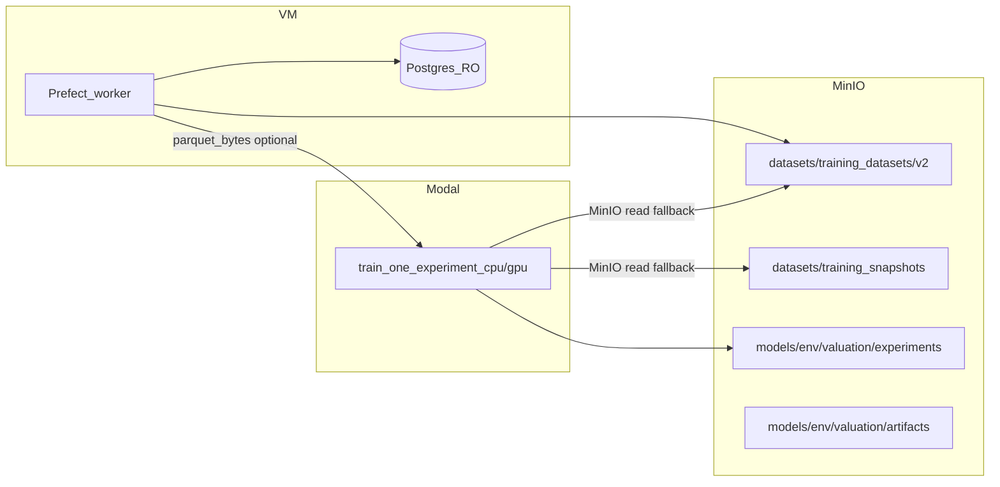

# Training pipeline (Prefect + Modal)

Last updated: 2026-05-20

## Overview

The **default training path** builds or reuses **narrow v2 Parquet datasets** in the MinIO **`datasets`** bucket under **`training_datasets/v2/<cache_key>/`** (`dataset.parquet` + `manifest.json`). The Prefect worker queries Postgres, merges pillars per [`FEATURE_SET_BUILD_MODULES`](../../modelling/config/feature_modules.py), uploads to MinIO, then runs **Modal** (or inline training) on that dataset.

**Legacy wide snapshots** remain under **`datasets/training_snapshots/<YYYYMMDDTHHMMSSZ>/`** and are used **only when `dataset_version` is pinned** to that timestamp.

**Modal dataset loading:** when the Parquet is small enough (under **`MODAL_PARQUET_PASSTHROUGH_MAX_BYTES`**, default ~95 MiB), the worker reads bytes from MinIO and passes them to Modal over **gRPC**, so Modal does not need to **read** the input object from MinIO. Modal still **writes** fitted artefacts to **`models/<MODEL_ENV>/valuation/experiments/<run_id>/`** (MinIO must remain reachable from Modal for uploads).

Promotion copies MinIO objects from **`experiments/`** to **`artifacts/`** server-side, then pins serving via `VALUATION_MODEL_OBJECT_KEY` as before.



## Phase 0 prerequisites

1. **Modal account** — install CLI (`pip install modal`), run `modal setup` / `modal token new`.
2. **Secrets on Modal** — example:

   ```bash
   modal secret create homeyai-training-secrets \
     MINIO_ENDPOINT=your-host:9000 \
     MINIO_ACCESS_KEY=... \
     MINIO_SECRET_KEY=... \
     MINIO_SECURE=false \
     MODEL_ENV=prod
   ```

   Ensure your firewall allows **Modal egress** to MinIO for **artefact uploads** (and for input reads when passthrough is skipped because the Parquet is too large).

3. **Connectivity smoke test** — deploy the training app, then:

   ```bash
   modal deploy modelling/modal_app.py
   ```

   The Modal image installs **`lightgbm>=4.0`** alongside XGBoost (see [`modelling/modal_app.py`](../../modelling/modal_app.py)). **Redeploy** after dependency changes so workers rebuild the image.

   Trigger a trivial experiment from the Prefect UI or API once v2 datasets exist (or let the flow build them).

4. **Prefect worker** — production Compose includes `prefect-worker` (pool `default-agent-pool`). Register deployments from `backend/`:

   ```bash
   cd backend && prefect deploy --all --prefect-file prefect.yaml
   ```

## Flows (Prefect)

| Deployment | Flow name | Purpose |
|------------|-----------|---------|
| _(manual)_ `homeyai-training-snapshot` | `homeyai-training-snapshot` | Optional **wide** legacy export → `datasets/training_snapshots/` (run `prefect deploy` manually if needed; see [`snapshot_flow.py`](../../backend/prefect/flows/snapshot_flow.py)) |
| `model-train-default` | `homeyai-model-train` | **Unpinned:** v2 cache / content-aware validation → build → Modal or inline (**one** experiment). **Pinned:** legacy `YYYYMMDDTHHMMSSZ` or existing v2 folder name. |
| `model-train-batch-default` | `homeyai-model-train-batch` | One resolved dataset **per distinct `(feature_set_id, rolling window years)`** — window from each experiment’s optional `mrt_pit_min_years`, else `MRT_PIT_MIN_YEARS` env — or a shared pin → **sequential** Modal or inline runs for [`PERFORMANCE_PLAN_V1`](../../modelling/config/experiment_batches.py) (or custom `experiment_ids`). Grid helpers: [`MRT_PRIMARY_SCHOOL_WINDOW_GRID`](../../modelling/config/experiment_batches.py), [`MODAL_L40S_CORE35_FULL_STACK_WINDOW_GRID_V1`](../../modelling/config/experiment_batches.py) (Core35 L40S grid uses `mrt_pit__macro__masterplan_proximity__primary_school__estate_maturity`; `metrics.json` records `flat_type_scope=core_35`). Flow parameters include optional **`feature_selection_policy`** (`advisory_only` \| `apply`) per batch — mirror of `HOMEYAI_FEATURE_SELECTION_POLICY` without rotating Modal secrets after redeploying [`modal_app.py`](../../modelling/modal_app.py). Targeted A/B shortlist: [`FEATURE_SELECTION_AB_V1`](../../modelling/config/experiment_batches.py). |

FastAPI `POST /api/admin/model/train` triggers **`homeyai-model-train` / `model-train-default`** (same as previous env vars). Optional JSON **`feature_selection_policy`** forwards to the flow when set.

`POST /api/admin/model/train/batch` triggers **`homeyai-model-train-batch` / `model-train-batch-default`** with optional body fields `experiment_ids`, `dataset_version`, `use_gpu`, `max_concurrent`, `feature_selection_policy`. Omit `experiment_ids` to use the default performance-plan list. Prefer **`use_gpu: false`** for long batches unless you explicitly want Modal T4 (**`train_one_experiment_gpu_gen`**) on every experiment with **`modal_profile=cpu`**. Experiments with **`modal_profile=l40s`** (e.g. `xgboost_tuned_gpu__core35_y5__mrt_primary_school` or `xgboost_tuned_gpu__core35_y5__full_stack`) always use **`train_one_experiment_l40s_gen`** regardless of `use_gpu`. Omit `dataset_version` so each experiment’s feature set **and** effective rolling window get its own cached narrow Parquet (return payload includes `dataset_versions_by_resolution`).

## Inline fallback

Set **`MODAL_ENABLED=false`** on the Prefect worker to run **`train_inline_on_worker_task`** (loads dataset from MinIO — legacy snapshot or `training_datasets/v2`, fits locally, uploads to MinIO `experiments/`). Useful without Modal credentials. The batch flow uses the same inline tasks when Modal is disabled.

Full-stack experiments in the default batch list (`*_full_stack`) still require POI coordinates / DB POI data as for single runs.

## V2 dataset cache and manifest

Unpinned training resolves a stable **`dataset_cache_key(feature_set_id, effective rolling window years)`** — years default from **`MRT_PIT_MIN_YEARS`** env unless the experiment sets **`mrt_pit_min_years`** (see [`dataset_builder.py`](../../modelling/data/dataset_builder.py), [`experiments.py`](../../modelling/config/experiments.py)).

**Cache reuse** requires all of:

1. **`dataset.parquet`** present at the v2 prefix.
2. Manifest **`created_at`** age ≤ **`SNAPSHOT_MAX_AGE_HOURS`** (default 24).
3. **`manifest.columns`** (when present on newer builds) matches the expected SQL pillar column set for that `feature_set_id`.
4. **`manifest.max_tx_month`** (when present) is ≥ **`MAX(month)`** from `hdb_resale_transactions` (cheap invalidation when new resale rows land).

Set **`TRAINING_FORCE_DATASET_REBUILD=1`** on the worker to skip cache hits and overwrite the v2 key.

## Data validation (early failure)

Dynamic dataset assembly in [`dataset_builder.py`](../../modelling/data/dataset_builder.py) enforces row-count invariants before upload:

1. **Baseline vs DB** — After loading the resale baseline frame, `len(df)` must equal **`get_training_window_summary` → `n_eligible_tx`** (same window and join semantics as the baseline SQL). Mismatches fail before pillar merges. Set **`TRAINING_SKIP_ELIGIBLE_ROW_CHECK=1`** only for rare local debugging.
2. **Merge preservation** — After MRT, masterplan, and estate merges, the row count must still match the post-baseline count. Masterplan land-use input is **deduplicated** to one row per `(enriched_addr_id, month)` before the left merge so duplicate transaction-grain keys cannot Cartesian-multiply rows.

When loading **`training_datasets/v2/<key>/dataset.parquet`**, [`snapshot_loader.py`](../../modelling/data/snapshot_loader.py) checks that **`len(parquet)` matches `manifest.json` `row_count`** for `schema=training_dataset_v2`, catching truncated uploads or stale manifests before training.

**Estate-maturity feature sets** (`estate_maturity` in [`FEATURE_SET_BUILD_MODULES`](../../modelling/config/feature_modules.py)): if a cached v2 manifest shows **`row_count` in the millions** while `get_training_window_summary` / baseline eligible counts are ~150k–200k, the Parquet was built with a bad merge—rebuild with **`TRAINING_FORCE_DATASET_REBUILD=1`** after deploying the panel-grain fix (see [`dataset_builder.py`](../../modelling/data/dataset_builder.py)). Discard models trained on inflated frames. **Land-use** feature sets that showed inflated counts before the masterplan dedupe fix need the same rebuild.

**Manifest fields** (v2) include: `schema`, `feature_set_id`, `build_modules`, `mrt_pit_min_years`, `row_count`, `column_count`, `columns`, `max_tx_month`, `window_start_month`, `window_end_month`, `created_at`.

## Snapshot size (bootstrap vs production)

- **Batch / Modal training** reads Parquet from **`datasets/training_datasets/v2/<version>/dataset.parquet`** by default (narrow columns per [`FEATURE_SET_BUILD_MODULES`](../../modelling/config/feature_modules.py)), or legacy **`datasets/training_snapshots/<dataset_version>/hdb_resale.parquet`** when `dataset_version` matches `YYYYMMDDTHHMMSSZ`.
- **Smoke / integration snapshots** — [`scripts/bootstrap_modal_dev_snapshot.py`](../../scripts/bootstrap_modal_dev_snapshot.py) uses `--limit 2000` and [`get_hdb_resale_bootstrap_query`](../../modelling/training_db.py); those uploads are **not** suitable for production batch training (~2k rows).
- **Wide legacy exports** — [`snapshot_flow.py`](../../backend/prefect/flows/snapshot_flow.py) + [`export_training_snapshot_to_minio`](../../modelling/runners/export_training_snapshot.py) produce **`training_snapshots/`** for tooling that expects one wide Parquet. These are **not** auto-consumed by unpinned training flows.
- **Guard** — Training flows enforce **`TRAINING_SNAPSHOT_MIN_ROWS`** (default `10000`; set `0` to disable). Pinning an old bootstrap version will **fail fast** (`TRAINING_SNAPSHOT_MIN_ROWS=0` disables the check for smoke tests).
- **Multi-year sweeps** — Pass experiments that set **`mrt_pit_min_years`** (e.g. [`MRT_PRIMARY_SCHOOL_WINDOW_GRID`](../../modelling/config/experiment_batches.py)) so the batch flow resolves **one narrow Parquet per `(feature_set_id, years)`**. Alternatively use [`modelling/runners/run_model_sweep.py`](../../modelling/runners/run_model_sweep.py) or export **separate** snapshots per window and pin **`dataset_version`** per run.

## Modal networking

- **Postgres TCP probe** inside Modal is **off by default**. Set **`HOMEYAI_MODAL_PROBE_POSTGRES=1`** in Modal secrets to fail fast when DB is unreachable (useful for POI/DB-heavy experiments).
- When **`parquet_bytes`** passthrough is used, Modal **skips the MinIO TCP preflight** for the dataset read path only; **upload** still requires working MinIO connectivity.

## Troubleshooting

- **Flow run / deployment status `Late` or work pool `NOT_READY`**: No worker is polling `default-agent-pool`. Check **Work Pools** in the Prefect UI — `last_polled` should be within the last minute.
  - **Dev server (port 4201)** — local `docker-compose.dev.yml` only queues runs; execution needs **`prefect-worker-dev`** on the VM: `docker compose up -d prefect-worker-dev` (see root `docker-compose.yml`). `prefect-worker` alone targets **prod** (`prefect-server:4200`) and will not drain dev runs.
  - **Prod server (port 4200)** — `docker compose up -d prefect-worker`.
  - After the worker is healthy, **late** scheduled runs are picked up automatically; no need to re-trigger unless the run was cancelled.
  - Register deployments from the **same filesystem the worker uses** (`/workspace/backend` on VM workers). Deploy from a laptop Docker container records `/app/…` and the VM worker cannot load the flow — redeploy on the VM, e.g. `docker compose exec prefect-worker-dev bash -lc 'cd /workspace/backend && prefect deploy prefect/flows/model_train_batch_flow.py:model_train_batch_flow --name model-train-batch-default --pool default-agent-pool --no-prompt'`.
- **`modal deploy` fails on GPU function**: Remove or comment out `train_one_experiment_gpu` / `train_one_experiment_l40s` (and `_gen` variants) in [`modelling/modal_app.py`](../../modelling/modal_app.py) if your Modal workspace has no GPU quota (CPU-only training remains via `train_one_experiment_cpu`).
- **`homeyai-model-train` cannot reach Modal**: Ensure **`MODAL_TOKEN_ID`** / **`MODAL_TOKEN_SECRET`** are set on the worker container or process running Prefect.
- **Training stops with “Training snapshot … has only N rows”**: Dataset manifest `row_count` is below **`TRAINING_SNAPSHOT_MIN_ROWS`**. Fix data windows / DB completeness, or set **`TRAINING_SNAPSHOT_MIN_ROWS=0`** for smoke tests.
- **`413 Content Too Large` from Modal**: Input Parquet exceeds Modal gRPC limits — reduce window/columns, or rely on automatic fallback: the worker omits `parquet_bytes` when over **`MODAL_PARQUET_PASSTHROUGH_MAX_BYTES`** so Modal reads the dataset from MinIO instead.

## Environment summary

See [`docs/reference/environment-variables.md`](../reference/environment-variables.md) for `MODAL_*`, `SNAPSHOT_MAX_AGE_HOURS`, **`TRAINING_FORCE_DATASET_REBUILD`**, **`MODAL_PARQUET_PASSTHROUGH_MAX_BYTES`**, **`HOMEYAI_MODAL_PROBE_POSTGRES`**, and `PREFECT_TRAINING_USE_GPU_DEFAULT`.
