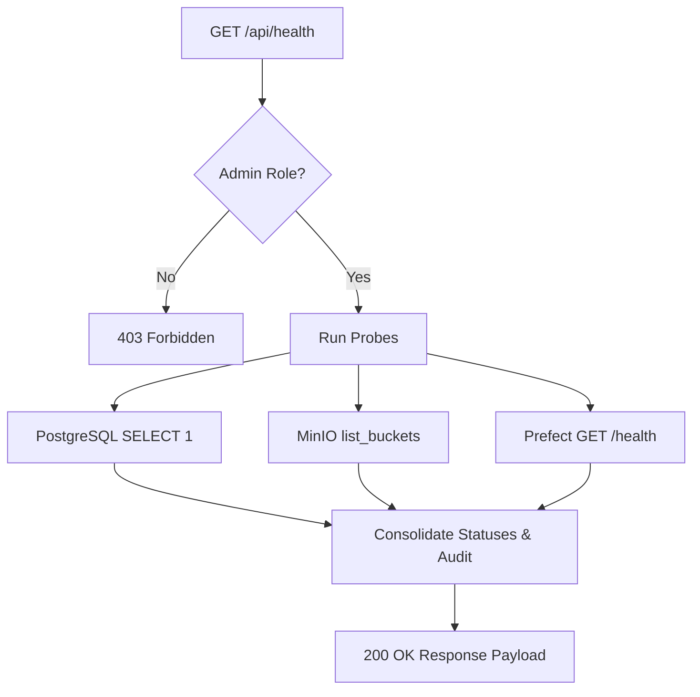

# System Health Monitor Specification

The System Health Monitor provides real-time validation of remote data pipeline layers, database integrations, and pipeline orchestration reachability. Since databases and object stores are hosted behind a secure VPN overlay, this feature serves as the primary diagnostic tool for team members to verify their Tailscale network connectivity.

---

## 1. Backend Diagnostics (`GET /api/health`)

The health probe backend is implemented in [main.py](file:///c:/Users/offic/Desktop/CSIT321-FYP-PredictingHomePrices/backend/main.py#L2589-L2677). It executes sequential, isolated reachability probes against three critical services.

### Access Control
*   **Authentication**: Bearer JWT token required.
*   **Authorization**: Restricted to users with the `admin` role. Non-admin calls receive a `403 Forbidden` response.

### Probe Mechanisms



1.  **PostgreSQL Probe**:
    *   **Action**: Executes a lightweight, non-destructive `SELECT 1` SQL query using the SQLAlchemy engine.
    *   **Port**: `5432` (Production) / `5433` (Development) on the remote VM.
    *   **Success Indicator**: Query execution succeeds.
    *   **Timeout/Error Handling**: Catches connection exceptions. If error signatures match timeouts or refused connections, appends hint suggesting Tailscale connectivity issue.

2.  **MinIO Object Storage Probe**:
    *   **Action**: Calls `list_buckets()` using the MinIO Python Client.
    *   **Port**: `9000` (API) on the remote VM.
    *   **Success Indicator**: Retrieves list of buckets successfully.
    *   **Security**: Probes are restricted to metadata queries; no raw file content is read or written.

3.  **Prefect Orchestration Engine Probe**:
    *   **Action**: Makes an asynchronous HTTP GET request to `{PREFECT_API_URL}/health` using `httpx`.
    *   **Port**: `4200` on the remote VM.
    *   **Success Indicator**: Receives a `200 OK` HTTP status response.

### Environment Audit
To assist developers in debugging setup mismatches, the endpoint returns a parsed layout of active configurations. All authentication credentials (passwords, secret access keys) are stripped out, returning only host addresses and ports:
*   `db_host` & `db_port`: Extracted from database connection URI.
*   `minio_endpoint`: Hostname and port of active MinIO client.
*   `prefect_api_url`: Configured Prefect server HTTP origin.

---

## 2. Frontend Health Dashboard (`/admin/health`)

The admin interface is implemented in [page.tsx](file:///c:/Users/offic/Desktop/CSIT321-FYP-PredictingHomePrices/frontend/src/app/admin/health/page.tsx). It displays real-time connection status cards, env audits, and connection reference commands.

### Key Capabilities
*   **Automatic Diagnostics**: Runs a full probe on page mount.
*   **Manual Trigger**: A "Re-test Connection" button invokes `runHealthCheck()` to clear cached error states.
*   **Timeout Mitigation**: Enforces a `12,000ms` abort controller signal. If the reverse proxy or API gateway times out (HTTP 504), the page renders dedicated tips suggesting Tailscale disconnected states.

### UI Components

#### Overall Banner
A primary banner shows consolidated health states:
*   `All systems operational` (Green): PostgreSQL, MinIO, Prefect, and API backend are fully accessible.
*   `One or more services are unreachable` (Red): One or more dependencies are offline.

#### Status Cards (`StatusCard`)
Four responsive grid cards represent each monitored layer. Cards toggle between `connected` (emerald), `disconnected` (red), `checking` (yellow), and `idle` (slate) badges. Detailed error traces are wrapped and printed beneath the status indicator if a service fails.

#### Environment Audit (`EnvCard`)
A dashboard comparing active backend settings against expected configurations. It highlights mismatched host configurations in orange (e.g. if the backend database host is pointing to a local host instead of the VM's Tailscale IP).

---

## 3. Tailscale VPN Integration

Because production databases and artifact storage servers are bound to internal VM interfaces, standard internet routing fails. Tailscale establishes a secure mesh network tunnel from local development setups to Oracle Cloud VM instances.

### Reachability Checks

If a developer encounters a disconnected state (`postgres` or `minio` cards show red), they should execute the following terminal diagnostic steps:

1.  **Verify tailscale interface daemon**:
    ```bash
    tailscale status
    ```
2.  **Ping target VM IP**:
    ```bash
    ping -c 3 <REMOTE_VM_IP>
    ```
3.  **Confirm VM Port Availability**:
    Ensure matching port configurations are set in the `.env` configuration file:
    *   PostgreSQL: `5432` / `5433`
    *   MinIO Console / API: `9001` / `9000`
    *   Prefect Server: `4200`
