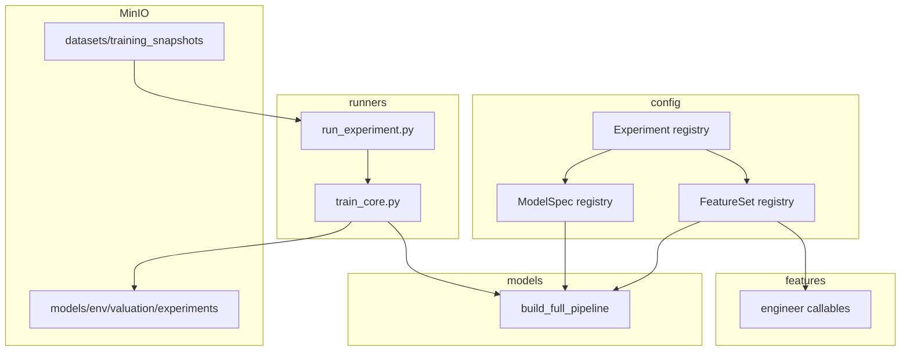

# Modelling System Design

Design rationale for the HomeyAI HDB resale valuation ML system. This document explains **what** the modelling package does and **why** key decisions were made.


| Document                                                                                        | Role                                                                          |
| ----------------------------------------------------------------------------------------------- | ----------------------------------------------------------------------------- |
| **This file**                                                                                   | Architecture, feature packs, preprocessing, validation strategy, integrations |
| `[modelling/README.md](README.md)`                                                              | Install, CLI commands, artefact paths                                         |
| `[docs/architecture/training-pipeline.md](../docs/architecture/training-pipeline.md)`           | Prefect snapshots, Modal training, MinIO promotion                            |
| `[ideation/MRT_FeatureEngineering_Strategy.md](../ideation/MRT_FeatureEngineering_Strategy.md)` | Full MRT PIT specification                                                    |
| `[docs/knowledge/poi-data-km.md](../docs/knowledge/poi-data-km.md)`                             | POI ingestion and storage                                                     |


---

## 1. Purpose and scope

HomeyAI predicts HDB resale transaction prices from structured transaction history plus geospatial enrichments (MRT accessibility, POI proximity, macro sentiment, master-plan land use). The modelling package is a **config-driven experiment framework**: feature sets, model specs, and named experiments are first-class registry objects; every training run is reproducible and persisted to MinIO.

**In scope here:** package layout, registries, feature-engineering rationale, sklearn pipeline design, temporal validation, artefact contract, backend touchpoints.

**Out of scope:** step-by-step CLI usage (see README), infrastructure orchestration (see training-pipeline doc), raw ETL/cleaning scripts under `backend/scripts/`.

**Why a modular package (not one notebook file)?**

1. **Feature coupling** — MRT, POI, macro, and land-use packs each have distinct data dependencies; separate `engineer_`* callables keep tests and ablations isolated.
2. **Experiment friction** — Named experiments + MinIO artefacts replace manual copy-paste of metric tables.
3. **Model persistence** — Pickle-safe `engineering_dispatch` lets full sklearn pipelines round-trip through `joblib` for serving.

---

## 2. Package architecture

```
modelling/
├── config/          FeatureSet · ModelSpec · Experiment · MinIO manifest · quality gates
├── data/            Training frame loaders (Postgres, MinIO parquet), temporal splits, DQ helpers
├── features/        Engineering: base, mrt_pit, poi_distancing, poi_amenity_v2, primary_school, macro_sentiment, masterplan_landuse_pit, estate_maturity
├── models/          build_full_pipeline · engineering_dispatch (pickle-safe)
├── eda/             Profiling, price trends, PSI
├── evaluation/      Target transforms · regression metrics
├── runners/         CLI entry points (train, EDA, sweep, snapshot export, MinIO upload)
├── storage/         MinIO I/O helpers
├── tests/           Pytest suite
├── outputs/         Generated EDA, completeness reports (gitignored artefacts)
└── modelling.py     Legacy notebook shim (§14)
```

### Registry objects


| Dataclass    | Module                   | Stores                                             |
| ------------ | ------------------------ | -------------------------------------------------- |
| `FeatureSet` | `config/feature_sets.py` | Column lists + `engineer` callable + kwargs        |
| `ModelSpec`  | `config/model_specs.py`  | Estimator + scaling + search strategy + param grid |
| `Experiment` | `config/experiments.py`  | Feature set ID + model ID + CV knobs               |


An `Experiment` is a frozen, named training configuration. CLI overrides use `dataclasses.replace` so registry definitions are never mutated.

### Dependency flow




**Data loading:** Runners call `modelling.data.loaders.load_training_frame` (Postgres joins by default; `--from-parquet-minio` reads manifest keys from `HOMEYAI_MINIO_SOURCES_JSON`). Splits live in `modelling.data.splits`.

---

## 3. Config layer

### 3.1 `FeatureSet` — static column lists

Each registry entry stores **explicit** `numeric_features` and `categorical_features` plus an `engineer` function. `build_full_pipeline` passes these lists directly to `ColumnTransformer` without re-inspecting the frame after engineering.

**Why static lists (not schema inference)?**

- Optional joins (MRT snapshot missing, POI coords absent) can silently add or drop columns; explicit lists fail fast at pipeline build time.
- The feature contract is readable in one place (`feature_sets.py`) and stable across train and serve.

**Why separate `engineer` callables per pack (not one multi-flag function)?**

- Single-responsibility engineers (`_eng_baseline`, `_eng_mrt_pit`, `_eng_poi`, …) are unit-testable without running the full stack.
- Composite sets compose callables (e.g. `_eng_all_features` = MRT+POI+macro then `append_masterplan_landuse_from_raw_columns`).

### 3.2 `ModelSpec` — estimators and search

Registered in `config/model_specs.py` via `build_default_specs()`:


| ID                  | Estimator                                           | Scaling | Search           | Target inverse  |
| ------------------- | --------------------------------------------------- | ------- | ---------------- | --------------- |
| `linear`            | `LinearRegression`                                  | Yes     | Grid             | Clipped `expm1` |
| `random_forest`     | `RandomForestRegressor`                             | No      | Random (10 iter) | Clipped         |
| `mlp`               | `MLPRegressor`                                      | Yes     | Random (8 iter)  | Clipped         |
| `xgboost`           | `XGBRegressor`                                      | No      | Random (6 iter)  | Plain `expm1`   |
| `xgboost_tuned_gpu` | XGB + `device=cuda`, `tree_method=hist`, `n_jobs=1` | No      | Random (15 iter) | Plain           |
| `xgboost_eco`       | XGB + `tree_method=hist`, `n_jobs=1`                | No      | Random           | Plain           |
| `xgboost_grouped`   | XGB + grouped categoricals                          | No      | Random           | Plain           |


XGBoost specs set `use_target_encoder=True` with `high_card_features=("town", "flat_model")` (or `flat_model_grouped` + `region` for grouped).

### 3.3 `Experiment` — named runs

`default_experiments(project_root)` in `config/experiments.py` binds feature set + model + defaults (`test_fraction=0.2`, `cv_splits=4`, `max_train_rows=None` — no training-row cap). See §13 for the full registry table.

Optional fields:

- `merge_coords_csv` — POI path when `data/pois/hdb_block_coords.csv` exists
- `extra_engineer_kwargs` — forwarded to the feature engineer
- `mrt_pit_min_years` — when set, overrides `MRT_PIT_MIN_YEARS` for narrow Parquet dataset SQL builds (Prefect dynamic cache key) and training metrics for that experiment
- `modal_profile` — when `MODAL_ENABLED=true`, selects Modal `**train_one_experiment_*_gen`** (`cpu` default, `t4` for legacy T4, `l40s` for CUDA `**xgboost_tuned_gpu**` on L40S)


| File                                        | Purpose                                                                                                       |
| ------------------------------------------- | ------------------------------------------------------------------------------------------------------------- |
| `config/minio_training_sources.sample.json` | Logical names → MinIO bucket keys (resale parquet, macro sidecars, MRT export)                                |
| `config/training_quality_gates.yml`         | Thresholds for `training_data_quality.py` (override via `HOMEYAI_DQ_CONFIG` or `HOMEYAI_DQ_<SECTION>__<KEY>`) |


---

## 4. Feature packs

Column names match `[config/feature_sets.py](config/feature_sets.py)` and the `*_NUMERIC_FEATURES` / categorical helpers under `[modelling/features/](features/)`. Pack tags in **Pack(s)** are documentation shorthand: composite feature sets (§4.7) are still **baseline +** the pillars they name.

**Conventions**

- `**baseline`** is included in almost every `FeatureSet`; it is still tagged here so you can scan one table.
- `**binary**` means numeric 0/1 (not pandas bool) for uniform `SimpleImputer` behaviour.
- **Overlapping names:** `dist_cbd` and `dist_airport` appear in both `poi_distancing` and masterplan proximity; `[feature_sets.py](config/feature_sets.py)` `_dedupe_nums()` keeps a single column when both stacks appear. The AB `**primary_school`** pack uses `**count_top20_schools_within_***` columns (integer counts), distinct from `**poi**`'s `**within_1km_top20_school**` / `**within_1km_2km_top20_school**` binaries (`poi_distancing`).
- **Not model columns:** `block`, `street_name`, raw `flat_type` strings, internal `sale_month` used only to build sin/cos, and RPI (target normalization only).
- **MRT pack:** model inputs use **scalars** including `**num_unique_lines_within_1km`**, `**nearest_planned_mrt_dist**`, and Python-derived `**project_completion_fraction**` (lifecycle progress 0→1 from announce to open; NaN when no planned cluster within 2 km, gated by `**has_future_upside**`). Per-line `**is_nearest_line_***` one-hots are **not** registered for modelling; raw SQL still returns `**nearest_op_lines`** / `**nearest_planned_lines**` for audits and registry checks.

**Sklearn `ColumnTransformer` (after feature engineering)** — Implemented in `[config/model_specs.py](config/model_specs.py)` `build_sklearn_preprocessor` and wired in `[models/pipelines.py](models/pipelines.py)` `build_full_pipeline`. Exact steps depend on `ModelSpec` from `build_default_specs()`.


| Branch                                                                                    | Implementation                                                                                                                                                                                                                                                                                                                                                      |
| ----------------------------------------------------------------------------------------- | ------------------------------------------------------------------------------------------------------------------------------------------------------------------------------------------------------------------------------------------------------------------------------------------------------------------------------------------------------------------- |
| **Numeric** (every name in `FeatureSet.numeric_features`, including 0/1 “binary” columns) | `SimpleImputer(strategy="median")`, then `StandardScaler()` **only if** `ModelSpec.scale_numeric` (`linear`, `mlp`, `ridge`). `random_forest`, `extra_trees`, XGBoost variants, `lightgbm`: median impute, **no** scaling.                                                                                                                                          |
| **Categorical** when `use_target_encoder` is false                                        | Single pipeline for all `categorical_features`: `SimpleImputer(strategy="most_frequent")` + `OneHotEncoder(handle_unknown="infrequent_if_exist", min_frequency=25, sparse_output=False)`. Hyperparameter search may override `min_frequency` for `linear` / `random_forest` / `mlp` / `ridge` / `extra_trees` (`preprocessor__categorical__onehot__min_frequency`). |
| **Categorical** when `use_target_encoder` is true (XGBoost*, `lightgbm`)                  | Columns in `categorical_features ∩ high_card_features` → `TargetEncoder(smoothing=20)` **only** (no separate imputer in this branch). Columns in `∩ low_card_features` → `most_frequent` + `OneHotEncoder(handle_unknown="ignore", sparse_output=False)`. Any remaining categoricals → same “legacy” OHE as above (`infrequent_if_exist`, `min_frequency=25`).      |


`high_card_features` / `low_card_features` in code: non-grouped XGBoost and `lightgbm` use `("town", "flat_model")`; `xgboost_grouped` uses `("town", "flat_model_grouped")` and `low_card_features=("region",)`.

**Label vs features:** the target is transformed separately (`log1p` on RPI-adjusted price via `TransformedTargetRegressor`, §9), not by this `ColumnTransformer`.

### 4.0 Master feature registry


| Feature                                        | Type        | Pack(s)                    | Preprocessing (sklearn, after engineering)                                                                                                                                                                          | Description                                                                                                                                                                                  |
| ---------------------------------------------- | ----------- | -------------------------- | ------------------------------------------------------------------------------------------------------------------------------------------------------------------------------------------------------------------- | -------------------------------------------------------------------------------------------------------------------------------------------------------------------------------------------- |
| `sale_year`                                    | numeric     | baseline                   | Median impute; `StandardScaler` only for `linear` / `mlp` / `ridge` (`ModelSpec.scale_numeric`, see §6)                                                                                                             | Calendar year of sale                                                                                                                                                                        |
| `sale_month_sin`                               | numeric     | baseline                   | Median impute; `StandardScaler` only for `linear` / `mlp` / `ridge` (`ModelSpec.scale_numeric`, see §6)                                                                                                             | Cyclic encoding of sale month (seasonality)                                                                                                                                                  |
| `sale_month_cos`                               | numeric     | baseline                   | Median impute; `StandardScaler` only for `linear` / `mlp` / `ridge` (`ModelSpec.scale_numeric`, see §6)                                                                                                             | Cyclic encoding of sale month (seasonality)                                                                                                                                                  |
| `floor_area_sqm`                               | numeric     | baseline                   | Median impute; `StandardScaler` only for `linear` / `mlp` / `ridge` (`ModelSpec.scale_numeric`, see §6)                                                                                                             | Primary size signal                                                                                                                                                                          |
| `flat_type_encoded`                            | numeric     | baseline                   | Median impute; `StandardScaler` only for `linear` / `mlp` / `ridge` (`ModelSpec.scale_numeric`, see §6)                                                                                                             | Ordinal 1–7 from normalized HDB `flat_type`                                                                                                                                                  |
| `remaining_lease_years`                        | numeric     | baseline                   | Median impute; `StandardScaler` only for `linear` / `mlp` / `ridge` (`ModelSpec.scale_numeric`, see §6)                                                                                                             | Years remaining on lease at sale                                                                                                                                                             |
| `storey_mid`                                   | numeric     | baseline                   | Median impute; `StandardScaler` only for `linear` / `mlp` / `ridge` (`ModelSpec.scale_numeric`, see §6)                                                                                                             | Mid-storey from `storey_range` (band edges not exposed)                                                                                                                                      |
| `lat`                                          | numeric     | baseline                   | Median impute; `StandardScaler` only for `linear` / `mlp` / `ridge` (`ModelSpec.scale_numeric`, see §6)                                                                                                             | Block centroid latitude WGS84 (OneMap enrichment)                                                                                                                                            |
| `lon`                                          | numeric     | baseline                   | Median impute; `StandardScaler` only for `linear` / `mlp` / `ridge` (`ModelSpec.scale_numeric`, see §6)                                                                                                             | Block centroid longitude WGS84 (OneMap enrichment)                                                                                                                                           |
| `months_since_2015`                            | numeric     | baseline_trend             | Median impute; `StandardScaler` only for `linear` / `mlp` / `ridge` (`ModelSpec.scale_numeric`, see §6)                                                                                                             | Anchored drift term for benchmark parity                                                                                                                                                     |
| `town`                                         | categorical | baseline, baseline_grouped | `TargetEncoder(smoothing=20)` when column is in `high_card_features` with `use_target_encoder` (XGBoost*, LightGBM); else `most_frequent` + `OneHotEncoder(handle_unknown='infrequent_if_exist', min_frequency=25)` | HDB town label                                                                                                                                                                               |
| `flat_model`                                   | categorical | baseline                   | `TargetEncoder(smoothing=20)` when column is in `high_card_features` with `use_target_encoder` (XGBoost*, LightGBM); else `most_frequent` + `OneHotEncoder(handle_unknown='infrequent_if_exist', min_frequency=25)` | Raw flat model (legacy sets; high-cardinality)                                                                                                                                               |
| `flat_model_grouped`                           | categorical | baseline_grouped           | `TargetEncoder(smoothing=20)` for `xgboost_grouped` (`high_card_features`); else same OHE path as `town`                                                                                                            | Rare models collapsed to OTHERS                                                                                                                                                              |
| `region`                                       | categorical | baseline_grouped           | `most_frequent` + `OneHotEncoder(handle_unknown='ignore')` for `xgboost_grouped` (`low_card_features`); else same OHE path as `town`                                                                                | Macro region derived from town                                                                                                                                                               |
| `dist_to_nearest_op_mrt`                       | numeric     | mrt                        | Median impute; `StandardScaler` only for `linear` / `mlp` / `ridge` (`ModelSpec.scale_numeric`, see §6)                                                                                                             | Geodesic distance to nearest operational MRT                                                                                                                                                 |
| `travel_time_to_active_mrt`                    | numeric     | mrt                        | Median impute; `StandardScaler` only for `linear` / `mlp` / `ridge` (`ModelSpec.scale_numeric`, see §6)                                                                                                             | Walk time to nearest active station (minutes)                                                                                                                                                |
| `pt_time_savings_vs_walk`                      | numeric     | mrt                        | Median impute; `StandardScaler` only for `linear` / `mlp` / `ridge` (`ModelSpec.scale_numeric`, see §6)                                                                                                             | Public-transit time saving vs walking                                                                                                                                                        |
| `line_connectivity_index`                      | numeric     | mrt                        | Median impute; `StandardScaler` only for `linear` / `mlp` / `ridge` (`ModelSpec.scale_numeric`, see §6)                                                                                                             | Transfer-free connectivity at nearest station                                                                                                                                                |
| `num_unique_lines_within_1km`                  | numeric     | mrt                        | Median impute; `StandardScaler` only for `linear` / `mlp` / `ridge` (`ModelSpec.scale_numeric`, see §6)                                                                                                             | Count of distinct operational MRT lines with any station within 1 km (geography) at PIT                                                                                                      |
| `days_since_mrt_announcement`                  | numeric     | mrt                        | Median impute; `StandardScaler` only for `linear` / `mlp` / `ridge` (`ModelSpec.scale_numeric`, see §6)                                                                                                             | Announcement-age channel (speculative timeline)                                                                                                                                              |
| `speculative_upside_score`                     | numeric     | mrt                        | Median impute; `StandardScaler` only for `linear` / `mlp` / `ridge` (`ModelSpec.scale_numeric`, see §6)                                                                                                             | Sigmoid composite of proximity and opening horizon                                                                                                                                           |
| `days_to_mrt_opening`                          | numeric     | mrt                        | Median impute; `StandardScaler` only for `linear` / `mlp` / `ridge` (`ModelSpec.scale_numeric`, see §6)                                                                                                             | Countdown to planned opening                                                                                                                                                                 |
| `nearest_planned_mrt_dist`                     | numeric     | mrt                        | Median impute; `StandardScaler` only for `linear` / `mlp` / `ridge` (`ModelSpec.scale_numeric`, see §6)                                                                                                             | Straight-line metres to nearest planned physical cluster (same 2 km window as `has_future_upside`)                                                                                           |
| `project_completion_fraction`                  | numeric     | mrt                        | Median impute; `StandardScaler` only for `linear` / `mlp` / `ridge` (`ModelSpec.scale_numeric`, see §6)                                                                                                             | Bounded [0,1] lifecycle progress `days_since_announcement / (days_since_announcement + days_to_opening)` (Python-derived); NaN when no planned cluster within 2 km (see `has_future_upside`) |
| `has_future_upside`                            | binary      | mrt                        | Median impute; `StandardScaler` only for `linear` / `mlp` / `ridge` (`ModelSpec.scale_numeric`, see §6)                                                                                                             | Planned station within 2 km at PIT                                                                                                                                                           |
| `is_proximity_nuisance`                        | binary      | mrt                        | Median impute; `StandardScaler` only for `linear` / `mlp` / `ridge` (`ModelSpec.scale_numeric`, see §6)                                                                                                             | Construction dis-amenity within 200 m                                                                                                                                                        |
| `dist_cbd`                                     | numeric     | poi, masterplan_proximity  | Median impute; `StandardScaler` only for `linear` / `mlp` / `ridge` (`ModelSpec.scale_numeric`, see §6)                                                                                                             | Great-circle distance to CBD reference point                                                                                                                                                 |
| `dist_airport`                                 | numeric     | poi, masterplan_proximity  | Median impute; `StandardScaler` only for `linear` / `mlp` / `ridge` (`ModelSpec.scale_numeric`, see §6)                                                                                                             | Great-circle distance to airport reference point                                                                                                                                             |
| `dist_nearest_top20_school`                    | numeric     | poi                        | Median impute; `StandardScaler` only for `linear` / `mlp` / `ridge` (`ModelSpec.scale_numeric`, see §6)                                                                                                             | Distance to nearest top-20 primary school POI                                                                                                                                                |
| `dist_nearest_any_school`                      | numeric     | poi                        | Median impute; `StandardScaler` only for `linear` / `mlp` / `ridge` (`ModelSpec.scale_numeric`, see §6)                                                                                                             | Distance to nearest primary school POI                                                                                                                                                       |
| `within_1km_top20_school`                      | binary      | poi                        | Median impute; `StandardScaler` only for `linear` / `mlp` / `ridge` (`ModelSpec.scale_numeric`, see §6)                                                                                                             | Top-20 school within 1 km (nearest-distance indicator; 0/1)                                                                                                                                  |
| `within_1km_2km_top20_school`                  | binary      | poi                        | Median impute; `StandardScaler` only for `linear` / `mlp` / `ridge` (`ModelSpec.scale_numeric`, see §6)                                                                                                             | Top-20 school in (1 km, 2 km] annulus (nearest-distance indicator; 0/1)                                                                                                                      |
| `count_top20_schools_within_1km`               | numeric     | primary_school             | Median impute; `StandardScaler` only for `linear` / `mlp` / `ridge` (`ModelSpec.scale_numeric`, see §6)                                                                                                             | Count of top-20 primary school POIs in [0, 1 km]                                                                                                                                             |
| `count_top20_schools_within_1km_2km`           | numeric     | primary_school             | Median impute; `StandardScaler` only for `linear` / `mlp` / `ridge` (`ModelSpec.scale_numeric`, see §6)                                                                                                             | Count of top-20 primary school POIs in (1 km, 2 km]                                                                                                                                          |
| `within_1km_any_pri_school`                    | binary      | poi                        | Median impute; `StandardScaler` only for `linear` / `mlp` / `ridge` (`ModelSpec.scale_numeric`, see §6)                                                                                                             | Any primary school within 1 km                                                                                                                                                               |
| `within_1km_2km_pri_school`                    | binary      | poi                        | Median impute; `StandardScaler` only for `linear` / `mlp` / `ridge` (`ModelSpec.scale_numeric`, see §6)                                                                                                             | Any primary school in (1 km, 2 km]                                                                                                                                                           |
| `dist_nearest_mall`                            | numeric     | poi, poi_v2                | Median impute; `StandardScaler` only for `linear` / `mlp` / `ridge` (`ModelSpec.scale_numeric`, see §6)                                                                                                             | Distance to nearest mall (`poi_distancing` and `poi_amenity_v2` share the name; `_dedupe_nums` keeps one column when both pillars appear)                                                    |
| `malls_within_2km`                             | numeric     | poi                        | Median impute; `StandardScaler` only for `linear` / `mlp` / `ridge` (`ModelSpec.scale_numeric`, see §6)                                                                                                             | Count of malls within 2 km                                                                                                                                                                   |
| `supermarkets_within_500m`                     | numeric     | poi                        | Median impute; `StandardScaler` only for `linear` / `mlp` / `ridge` (`ModelSpec.scale_numeric`, see §6)                                                                                                             | Count of supermarkets within 500 m                                                                                                                                                           |
| `markets_within_500m`                          | numeric     | poi                        | Median impute; `StandardScaler` only for `linear` / `mlp` / `ridge` (`ModelSpec.scale_numeric`, see §6)                                                                                                             | Count of hawker/NEA markets within 500 m                                                                                                                                                     |
| `dist_nearest_park`                            | numeric     | poi                        | Median impute; `StandardScaler` only for `linear` / `mlp` / `ridge` (`ModelSpec.scale_numeric`, see §6)                                                                                                             | Distance to nearest park/nature reserve                                                                                                                                                      |
| `is_park_200m`                                 | binary      | poi                        | Median impute; `StandardScaler` only for `linear` / `mlp` / `ridge` (`ModelSpec.scale_numeric`, see §6)                                                                                                             | Park within 200 m                                                                                                                                                                            |
| `dist_nearest_pcn`                             | numeric     | poi                        | Median impute; `StandardScaler` only for `linear` / `mlp` / `ridge` (`ModelSpec.scale_numeric`, see §6)                                                                                                             | Distance to nearest park connector                                                                                                                                                           |
| `gravity_malls`                                | numeric     | poi                        | Median impute; `StandardScaler` only for `linear` / `mlp` / `ridge` (`ModelSpec.scale_numeric`, see §6)                                                                                                             | Gravity score over nearest malls                                                                                                                                                             |
| `gravity_schools`                              | numeric     | poi                        | Median impute; `StandardScaler` only for `linear` / `mlp` / `ridge` (`ModelSpec.scale_numeric`, see §6)                                                                                                             | Gravity score over nearest schools                                                                                                                                                           |
| `gravity_parks`                                | numeric     | poi                        | Median impute; `StandardScaler` only for `linear` / `mlp` / `ridge` (`ModelSpec.scale_numeric`, see §6)                                                                                                             | Gravity score over nearest parks                                                                                                                                                             |
| `gravity_markets`                              | numeric     | poi                        | Median impute; `StandardScaler` only for `linear` / `mlp` / `ridge` (`ModelSpec.scale_numeric`, see §6)                                                                                                             | Gravity score over nearest markets                                                                                                                                                           |
| `dist_nearest_primary_school`                  | numeric     | poi_v2                     | Median impute; `StandardScaler` only for `linear` / `mlp` / `ridge` (`ModelSpec.scale_numeric`, see §6)                                                                                                             | Distance to nearest primary school (slim pack)                                                                                                                                               |
| `is_within_1km_primary_school`                 | binary      | poi_v2                     | Median impute; `StandardScaler` only for `linear` / `mlp` / `ridge` (`ModelSpec.scale_numeric`, see §6)                                                                                                             | Primary school within 1 km                                                                                                                                                                   |
| `is_within_2km_primary_school`                 | binary      | poi_v2                     | Median impute; `StandardScaler` only for `linear` / `mlp` / `ridge` (`ModelSpec.scale_numeric`, see §6)                                                                                                             | Primary school within 2 km                                                                                                                                                                   |
| `dist_nearest_hawker`                          | numeric     | poi_v2                     | Median impute; `StandardScaler` only for `linear` / `mlp` / `ridge` (`ModelSpec.scale_numeric`, see §6)                                                                                                             | Distance to nearest hawker/NEA market                                                                                                                                                        |
| `hawker_count_within_1km`                      | numeric     | poi_v2                     | Median impute; `StandardScaler` only for `linear` / `mlp` / `ridge` (`ModelSpec.scale_numeric`, see §6)                                                                                                             | Hawker/market count within 1 km                                                                                                                                                              |
| `mall_count_within_1_5km`                      | numeric     | poi_v2                     | Median impute; `StandardScaler` only for `linear` / `mlp` / `ridge` (`ModelSpec.scale_numeric`, see §6)                                                                                                             | Mall count within 1.5 km                                                                                                                                                                     |
| `volume_lagged_3m`                             | numeric     | macro                      | Median impute; `StandardScaler` only for `linear` / `mlp` / `ridge` (`ModelSpec.scale_numeric`, see §6)                                                                                                             | Nationwide resale volume momentum (3-month lag)                                                                                                                                              |
| `interest_rate_lagged`                         | numeric     | macro                      | Median impute; `StandardScaler` only for `linear` / `mlp` / `ridge` (`ModelSpec.scale_numeric`, see §6)                                                                                                             | Blended lagged interest rate series                                                                                                                                                          |
| `area_comm_500m`                               | numeric     | masterplan_area            | Median impute; `StandardScaler` only for `linear` / `mlp` / `ridge` (`ModelSpec.scale_numeric`, see §6)                                                                                                             | Intersection area m² with comm land use in 500 m buffer                                                                                                                                      |
| `area_comm_1000m`                              | numeric     | masterplan_area            | Median impute; `StandardScaler` only for `linear` / `mlp` / `ridge` (`ModelSpec.scale_numeric`, see §6)                                                                                                             | Intersection area m² with comm land use in 1000 m buffer                                                                                                                                     |
| `area_comm_1500m`                              | numeric     | masterplan_area            | Median impute; `StandardScaler` only for `linear` / `mlp` / `ridge` (`ModelSpec.scale_numeric`, see §6)                                                                                                             | Intersection area m² with comm land use in 1500 m buffer                                                                                                                                     |
| `area_park_500m`                               | numeric     | masterplan_area            | Median impute; `StandardScaler` only for `linear` / `mlp` / `ridge` (`ModelSpec.scale_numeric`, see §6)                                                                                                             | Intersection area m² with park land use in 500 m buffer                                                                                                                                      |
| `area_park_1000m`                              | numeric     | masterplan_area            | Median impute; `StandardScaler` only for `linear` / `mlp` / `ridge` (`ModelSpec.scale_numeric`, see §6)                                                                                                             | Intersection area m² with park land use in 1000 m buffer                                                                                                                                     |
| `area_park_1500m`                              | numeric     | masterplan_area            | Median impute; `StandardScaler` only for `linear` / `mlp` / `ridge` (`ModelSpec.scale_numeric`, see §6)                                                                                                             | Intersection area m² with park land use in 1500 m buffer                                                                                                                                     |
| `area_sports_500m`                             | numeric     | masterplan_area            | Median impute; `StandardScaler` only for `linear` / `mlp` / `ridge` (`ModelSpec.scale_numeric`, see §6)                                                                                                             | Intersection area m² with sports land use in 500 m buffer                                                                                                                                    |
| `area_sports_1000m`                            | numeric     | masterplan_area            | Median impute; `StandardScaler` only for `linear` / `mlp` / `ridge` (`ModelSpec.scale_numeric`, see §6)                                                                                                             | Intersection area m² with sports land use in 1000 m buffer                                                                                                                                   |
| `area_sports_1500m`                            | numeric     | masterplan_area            | Median impute; `StandardScaler` only for `linear` / `mlp` / `ridge` (`ModelSpec.scale_numeric`, see §6)                                                                                                             | Intersection area m² with sports land use in 1500 m buffer                                                                                                                                   |
| `area_health_500m`                             | numeric     | masterplan_area            | Median impute; `StandardScaler` only for `linear` / `mlp` / `ridge` (`ModelSpec.scale_numeric`, see §6)                                                                                                             | Intersection area m² with health land use in 500 m buffer                                                                                                                                    |
| `area_health_1000m`                            | numeric     | masterplan_area            | Median impute; `StandardScaler` only for `linear` / `mlp` / `ridge` (`ModelSpec.scale_numeric`, see §6)                                                                                                             | Intersection area m² with health land use in 1000 m buffer                                                                                                                                   |
| `area_health_1500m`                            | numeric     | masterplan_area            | Median impute; `StandardScaler` only for `linear` / `mlp` / `ridge` (`ModelSpec.scale_numeric`, see §6)                                                                                                             | Intersection area m² with health land use in 1500 m buffer                                                                                                                                   |
| `area_worship_500m`                            | numeric     | masterplan_area            | Median impute; `StandardScaler` only for `linear` / `mlp` / `ridge` (`ModelSpec.scale_numeric`, see §6)                                                                                                             | Intersection area m² with worship land use in 500 m buffer                                                                                                                                   |
| `area_worship_1000m`                           | numeric     | masterplan_area            | Median impute; `StandardScaler` only for `linear` / `mlp` / `ridge` (`ModelSpec.scale_numeric`, see §6)                                                                                                             | Intersection area m² with worship land use in 1000 m buffer                                                                                                                                  |
| `area_worship_1500m`                           | numeric     | masterplan_area            | Median impute; `StandardScaler` only for `linear` / `mlp` / `ridge` (`ModelSpec.scale_numeric`, see §6)                                                                                                             | Intersection area m² with worship land use in 1500 m buffer                                                                                                                                  |
| `nearby_high_density_score`                    | numeric     | masterplan_proximity       | Median impute; `StandardScaler` only for `linear` / `mlp` / `ridge` (`ModelSpec.scale_numeric`, see §6)                                                                                                             | Mean GPR-like density in local buffer from master plan                                                                                                                                       |
| `dist_to_nearest_b2_zone`                      | numeric     | masterplan_proximity       | Median impute; `StandardScaler` only for `linear` / `mlp` / `ridge` (`ModelSpec.scale_numeric`, see §6)                                                                                                             | Planar distance to nearest B2 zoning polygon                                                                                                                                                 |
| `b2_zoning_ratio_1km`                          | numeric     | masterplan_proximity       | Median impute; `StandardScaler` only for `linear` / `mlp` / `ridge` (`ModelSpec.scale_numeric`, see §6)                                                                                                             | Share of B2 land use in 1 km disk                                                                                                                                                            |
| `dist_to_nearest_business_park`                | numeric     | masterplan_proximity       | Median impute; `StandardScaler` only for `linear` / `mlp` / `ridge` (`ModelSpec.scale_numeric`, see §6)                                                                                                             | Distance to nearest Business Park zoning                                                                                                                                                     |
| `dist_to_nearest_cemetery`                     | numeric     | masterplan_proximity       | Median impute; `StandardScaler` only for `linear` / `mlp` / `ridge` (`ModelSpec.scale_numeric`, see §6)                                                                                                             | Distance to nearest Cemetery land use                                                                                                                                                        |
| `dist_to_nearest_special_use`                  | numeric     | masterplan_proximity       | Median impute; `StandardScaler` only for `linear` / `mlp` / `ridge` (`ModelSpec.scale_numeric`, see §6)                                                                                                             | Distance to nearest Special Use land use                                                                                                                                                     |
| `density_age_interaction`                      | numeric     | masterplan_proximity       | Median impute; `StandardScaler` only for `linear` / `mlp` / `ridge` (`ModelSpec.scale_numeric`, see §6)                                                                                                             | Engineered interaction after snapshot merge                                                                                                                                                  |
| `hub_score`                                    | numeric     | masterplan_proximity       | Median impute; `StandardScaler` only for `linear` / `mlp` / `ridge` (`ModelSpec.scale_numeric`, see §6)                                                                                                             | Engineered hub composite after snapshot merge                                                                                                                                                |
| `avg_residential_block_age_years`              | numeric     | estate                     | Median impute; `StandardScaler` only for `linear` / `mlp` / `ridge` (`ModelSpec.scale_numeric`, see §6)                                                                                                             | Mean residential block catalogue age in town (PIT)                                                                                                                                           |
| `town_completed_residential_units_stock`       | numeric     | estate                     | Median impute; `StandardScaler` only for `linear` / `mlp` / `ridge` (`ModelSpec.scale_numeric`, see §6)                                                                                                             | Completed standing stock in town                                                                                                                                                             |
| `town_land_area_km2`                           | numeric     | estate                     | Median impute; `StandardScaler` only for `linear` / `mlp` / `ridge` (`ModelSpec.scale_numeric`, see §6)                                                                                                             | Town land area km² (URA-style union)                                                                                                                                                         |
| `town_dwelling_unit_density`                   | numeric     | estate                     | Median impute; `StandardScaler` only for `linear` / `mlp` / `ridge` (`ModelSpec.scale_numeric`, see §6)                                                                                                             | Dwelling units per km²                                                                                                                                                                       |
| `town_units_under_construction`                | numeric     | estate                     | Median impute; `StandardScaler` only for `linear` / `mlp` / `ridge` (`ModelSpec.scale_numeric`, see §6)                                                                                                             | FY under-construction units for FY of resale month                                                                                                                                           |
| `town_hdb_completed_units_roll36m`             | numeric     | estate                     | Median impute; `StandardScaler` only for `linear` / `mlp` / `ridge` (`ModelSpec.scale_numeric`, see §6)                                                                                                             | Sum of FY completed units over trailing 36 months                                                                                                                                            |
| `town_supply_maturity_ratio`                   | numeric     | estate                     | Median impute; `StandardScaler` only for `linear` / `mlp` / `ridge` (`ModelSpec.scale_numeric`, see §6)                                                                                                             | Under-construction divided by standing stock                                                                                                                                                 |
| `town_bto_velocity_36m`                        | numeric     | estate                     | Median impute; `StandardScaler` only for `linear` / `mlp` / `ridge` (`ModelSpec.scale_numeric`, see §6)                                                                                                             | Alias engineering column from roll-36m completed units                                                                                                                                       |
| `log1p_town_completed_residential_units_stock` | numeric     | estate                     | Median impute; `StandardScaler` only for `linear` / `mlp` / `ridge` (`ModelSpec.scale_numeric`, see §6)                                                                                                             | log1p transform of standing stock                                                                                                                                                            |
| `log1p_town_hdb_roll36_completed`              | numeric     | estate                     | Median impute; `StandardScaler` only for `linear` / `mlp` / `ridge` (`ModelSpec.scale_numeric`, see §6)                                                                                                             | log1p transform of roll-36m completed                                                                                                                                                        |
| `log1p_town_units_under_construction`          | numeric     | estate                     | Median impute; `StandardScaler` only for `linear` / `mlp` / `ridge` (`ModelSpec.scale_numeric`, see §6)                                                                                                             | log1p transform of under-construction count                                                                                                                                                  |
| `log1p_town_dwelling_unit_density`             | numeric     | estate                     | Median impute; `StandardScaler` only for `linear` / `mlp` / `ridge` (`ModelSpec.scale_numeric`, see §6)                                                                                                             | log1p transform of density                                                                                                                                                                   |
| `log1p_town_supply_maturity_ratio`             | numeric     | estate                     | Median impute; `StandardScaler` only for `linear` / `mlp` / `ridge` (`ModelSpec.scale_numeric`, see §6)                                                                                                             | log1p transform of supply maturity ratio                                                                                                                                                     |


**Row count:** 90 distinct registered feature names (each `area_*` buffer counts once).

### 4.1 `baseline_v1` — core HDB structure

**Module:** `[features/base.py](features/base.py)` (`engineer_base_features`)

**Numeric and categorical columns:** §4.0 (`baseline`, optional `baseline_trend`, `baseline_grouped`). Parsing of storey bands aligns with `[backend/hdb_storey.py](../../backend/hdb_storey.py)`. Raw `**flat_type`** strings stay on raw rows for reporting only. When `lat`/`lon` are absent, columns are still emitted as NaN to keep the feature contract stable; the default Postgres training path requires non-null enrichment coordinates (`training_db._resale_jobs_oe_where_fragment`).

**Why pass `lat`/`lon` into tabular models:** tree ensembles use axis-aligned splits, so stacked trees can approximate local premiums; coordinates also carry micro-location signal and smooth across `town` boundaries. For ablations, watch correlations among `town`/`region`, `dist_cbd`/`dist_airport`, and coordinates (§5).

**Deliberately excluded:** `block`, `street_name` — location is via coordinates, town/region, and pillar packs instead.

### 4.2 `mrt_pit` — point-in-time MRT

**Module:** `[features/mrt_pit.py](features/mrt_pit.py)` · **Spec:** `[ideation/MRT_FeatureEngineering_Strategy.md](../ideation/MRT_FeatureEngineering_Strategy.md)`

**Two-pass materialisation**


| Pass | Component                                           | Role                                                                                    |
| ---- | --------------------------------------------------- | --------------------------------------------------------------------------------------- |
| 1    | `backend/scripts/engineer_mrt_routing.py`           | Up to 4 line-diverse physical stations within 2 km; OneMap walk + PT → `hdb_mrt_routes` |
| 2    | `hdb_mrt_features_at` + `build_mrt_pit_snapshot.py` | Transaction-date filters; operational features only when `opening_date <= tx_date`      |


Pass 1 is a pre-materialised superset; pass 2 is the **feature gate** (no look-ahead). **Model columns:** §4.0 (`mrt`). Binaries use **numeric 0/1** (not bool) so `SimpleImputer` handles them uniformly.

MRT line indicator columns follow `[modelling/_mrt_lines.json](_mrt_lines.json)` and `[line_vocab._MRT_NEAREST_LINE_INDICATOR_CODES](features/line_vocab.py)`; each is 1 iff that line appears in `**nearest_op_lines` OR `nearest_planned_lines`** at transaction PIT.

**Data dependency:** Postgres `hdb_mrt_features_pit_snapshot` or parquet sidecar `data/hdb_mrt_features.parquet`; window via `MRT_PIT_MIN_YEARS` or per-experiment `mrt_pit_min_years`.

### 4.3 `poi_distancing` — amenity proximity

**Module:** `[features/poi_distancing.py](features/poi_distancing.py)` · **KM:** `[docs/knowledge/poi-data-km.md](../docs/knowledge/poi-data-km.md)`

**Design:** vectorised Haversine, BallTree (`metric=haversine`) for nearest-N and radius counts, gravity scores `Σ exp(-d/scale)` over nearest POIs. **Fail-fast** if `lat`/`lon` are missing (use DB loader or `data/pois/hdb_block_coords.csv`). **Model columns:** §4.0 (`poi`).

**Data dependency:** `data/pois/*` GeoJSON/CSV **or** Postgres `poi_locations` with `use_db=True`.

#### `poi_amenity_v2` — slim school / hawker / mall pack

**Module:** `[features/poi_amenity_v2.py](features/poi_amenity_v2.py)` · **Roadmap:** `[docs/knowledge/poi-amenity-v2-roadmap.md](../docs/knowledge/poi-amenity-v2-roadmap.md)`

Same POI assets as `poi_distancing`; **§4.0 (`poi_v2`)** replaces the wide parks/PCN/gravity/CBD bundle. With Postgres (`use_db=True`), nearest school and mall distances (and generic primary radius flags that mirror `hdb_poi_features`) can **blend from `hdb_poi_features`**; hawker and `mall_count_within_1_5km` remain BallTree-computed where the precompute table lacks them.

#### `primary_school` — top-20 annulus counts (AB)

**Module:** `[features/primary_school.py](features/primary_school.py)`

**§4.0** tags `**count_top20_schools_within_1km`** and `**count_top20_schools_within_1km_2km**` (`primary_school` only). `**dist_nearest_top20_school` is intentionally omitted** so the pack does not expose continuous distance; that distance still exists in `**poi_distancing`**. Counts are always computed from POI points (local files or `poi_locations`); `**hdb_poi_features**` stores binaries only and is **not** blended here.

Registered composite IDs including schools and masterplan splits (area vs proximity) are listed in §4.7 and §13. Rolling SQL window length follows `MRT_PIT_MIN_YEARS` unless an experiment sets `mrt_pit_min_years`.

### 4.4 `macro_sentiment` — market-wide signals

**Module:** `[features/macro_sentiment.py](features/macro_sentiment.py)` · **Model columns:** §4.0 (`macro`).

**RPI:** `hdb_resale_price_index` (Postgres + MinIO/API fallback in `targets/rpi_normalization.py`) scales the **training label** to constant 2009-Q1 dollars; RPI levels are **not** macro feature columns.

**Data dependency:** MinIO manifest keys `global_volume_monthly`, `macro_interest_csv`; `macro_rpi_csv` only for label normalization fallbacks. Volume sidecar from `runners/build_macro_sidecar.py`.

### 4.5 `masterplan_landuse_pit` — land-use polygons

**Modules:** `[features/masterplan_landuse_pit.py](features/masterplan_landuse_pit.py)`, `[features/masterplan_loi_proximity.py](features/masterplan_loi_proximity.py)`, `[features/land_use_revision.py](features/land_use_revision.py)`, `[features/masterplan_landuse_geometry.py](features/masterplan_landuse_geometry.py)`

**Model columns:** §4.0 (`masterplan_area`, `masterplan_proximity`). Snapshot merges attach polygon intersection areas and LOI proximity scalars; `density_age_interaction` and `hub_score` are derived in Python after merge.

**PIT revision:** `revision_key_for_tx_month` selects the latest Land Use GeoJSON revision known as-of transaction month (`masterplan_revision_catalog`).

**Data dependency:** `masterplan_landuse_pit_scalars` in Postgres; build via `runners/build_masterplan_landuse_pit_snapshot.py`. LOI semantics: `[docs/knowledge/masterplan-land-use-loi-from-lu-desc.md](../docs/knowledge/masterplan-land-use-loi-from-lu-desc.md)`.

**Schema note:** Alembic `e9a0b1c2d3e4` (B2/BP proximity); `f1a2b3c4d5e7` (cemetery/special use). Re-run snapshot after migrations. Drop obsolete `area_industrial_b2_*` in dev DBs if present.

`FeatureSet` entries split **area-only** vs **proximity-only** masterplan numerics for ablations (`mrt_pit__masterplan_area__primary_school`, etc.); the legacy full-land-use id `mrt_pit__masterplan_landuse_pit__primary_school` uses the combined numeric list.

### 4.6 `estate_maturity` — town supply lifecycle

**Modules:** merge in `training_db.query_estate_maturity_window_dataframe`; `[features/estate_maturity.py](features/estate_maturity.py)` · **KM:** `[docs/knowledge/hdb-estate-maturity-features.md](../docs/knowledge/hdb-estate-maturity-features.md)` · **Model columns:** §4.0 (`estate`).

**V2 dataset grain:** parquet builds load the pillar from `**hdb_estate_maturity_by_town_month`** (one row per `(town_normalized, year_month)`). Normalize resale `town` with `modelling.town_geo.normalize_hdb_town_label` before merging. **Never** merge transaction-grain frames on `(town, month)` alone — that **Cartesian-multiplies** rows.

**Interpretation:** FY under-construction vs completed roll-36m capture different BTO lifecycle phases; they are not causal infrastructure identifiers.

**Sidecar tables:** `hdb_town_completion_fy`, `hdb_estate_maturity_by_town_month`, `hdb_resale_town_land_area_km2`, `hdb_resale_town_planning_area`.

**Populate:** `backend/scripts/populate_resale_town_land_area.py`, `ingest_hdb_town_completion_fy.py`, `materialize_hdb_estate_maturity_panel.py` (after Alembic `d4e3f2a1b9c8`).

### 4.7 Composite feature sets

Composite IDs concatenate pack names. Engineers chain base → optional packs → column union in `build_feature_set_registry`. For a given ID, the numeric union is the set of §4.0 rows whose **Pack(s)** column intersects the pillars in that ID; `[feature_sets.py](config/feature_sets.py)` `_dedupe_nums()` collapses duplicate names (e.g. `dist_cbd` / `dist_airport` when POI and masterplan stacks both register them).


| Feature set ID                                                          | Composition                                                                                                                                                    |
| ----------------------------------------------------------------------- | -------------------------------------------------------------------------------------------------------------------------------------------------------------- |
| `baseline_v1`                                                           | Base only                                                                                                                                                      |
| `baseline_v1__months_since_2015`                                        | Base + trend                                                                                                                                                   |
| `baseline_grouped_v1`                                                   | Grouped categoricals                                                                                                                                           |
| `baseline_v1__macro`                                                    | Base + macro                                                                                                                                                   |
| `mrt_pit`                                                               | Base + MRT (scalars/binaries + line-coverage counts; no per-line one-hots)                                                                                     |
| `mrt_pit__macro`                                                        | Base + MRT + macro                                                                                                                                             |
| `poi_distancing`                                                        | Base + POI                                                                                                                                                     |
| `poi_amenity_v2`                                                        | Base + slim POI (school / hawker / mall); optional blend from `hdb_poi_features`                                                                               |
| `poi_distancing__macro`                                                 | Base + POI + macro                                                                                                                                             |
| `mrt_pit__poi_distancing`                                               | Base + MRT + POI                                                                                                                                               |
| `mrt_pit__poi_amenity_v2`                                               | Base + MRT + slim POI                                                                                                                                          |
| `primary_school`                                                        | Base + top-20 school annulus counts only (no distance column)                                                                                                  |
| `mrt_pit__primary_school`                                               | Base + MRT + top-20 school counts                                                                                                                              |
| `mrt_pit__primary_school__estate_maturity`                              | Base + MRT + top-20 school counts + estate maturity                                                                                                            |
| `mrt_pit__masterplan_landuse_pit__primary_school`                       | Base + MRT + full masterplan + top-20 school counts (legacy id; prefer `mrt_pit__masterplan_area_proximity__primary_school`)                                   |
| `mrt_pit__masterplan_area__primary_school`                              | Base + MRT + masterplan **area** pack + school counts                                                                                                          |
| `mrt_pit__masterplan_proximity__primary_school`                         | Base + MRT + masterplan **proximity** pack + school counts                                                                                                     |
| `mrt_pit__masterplan_area_proximity__primary_school`                    | Base + MRT + full masterplan numerics + school counts                                                                                                          |
| `mrt_pit__masterplan_area__primary_school__estate_maturity`             | Base + MRT + masterplan area + school counts + estate                                                                                                          |
| `mrt_pit__masterplan_proximity__primary_school__estate_maturity`        | Base + MRT + masterplan proximity + school counts + estate                                                                                                     |
| `mrt_pit__masterplan_landuse_pit__primary_school__estate_maturity`      | Base + MRT + full masterplan + school counts + estate                                                                                                          |
| `mrt_pit__poi_distancing__macro`                                        | Base + MRT + POI + macro                                                                                                                                       |
| `masterplan_landuse_pit`                                                | Base + land use                                                                                                                                                |
| `baseline_v1__macro__masterplan_landuse_pit`                            | Base + macro + land use                                                                                                                                        |
| `baseline_v1__macro__masterplan_landuse_pit__mrt_pit`                   | Base + macro + land use + MRT                                                                                                                                  |
| `baseline_v1__estate_maturity`                                          | Base + estate maturity town-month panel                                                                                                                        |
| `baseline_v1__macro__estate_maturity`                                   | Base + macro + estate maturity                                                                                                                                 |
| `baseline_v1__macro__masterplan_landuse_pit__mrt_pit__estate_maturity`  | Full stack + estate maturity                                                                                                                                   |
| `mrt_pit__poi_distancing__macro__masterplan_landuse_pit`                | Full stack (legacy categoricals)                                                                                                                               |
| `mrt_pit__poi_distancing__macro__masterplan_landuse_pit__grouped`       | Full stack + grouped categoricals                                                                                                                              |
| `mrt_pit__macro__masterplan_proximity__primary_school__estate_maturity` | Core35 L40S grid: MRT + macro + masterplan proximity (no area) + top-20 school counts + estate; POI distance numerics excluded; no `sale_year` in model inputs |


---

## 5. Feature evaluation and selection strategy

Feature columns are chosen via **registry IDs** in `[config/feature_sets.py](config/feature_sets.py)`, not by automated subset selection. That keeps training and serving contracts aligned but leaves redundancy, multicollinearity, and weak signals unexamined unless operators read artefacts.

This section lists **known risks** across packs and the **four-step diagnostic pipeline** emitted on every successful training run (and available standalone via CLI). Reports are **advisory**: they do not drop columns from the fitted pipeline unless engineering code or new `FeatureSet` definitions change.

### 5.1 Risks by pack

**Column names** for each pack are listed in **§4.0** (master feature registry).

**Baseline (`baseline_v1`)**

- **Missing lease signal:** Ingestion often supplies `remaining_lease_years` directly; there is no `remaining_lease_missing_flag`, so median imputation hides structural missingness.
- **Lease vs age:** Remaining lease, implicit flat age, and `sale_year` can be strongly dependent—watch correlation clusters before trusting linear baselines.

**MRT (`mrt_pit`)**

- **Line coverage vs fragmentation:** `num_unique_lines_within_1km` summarizes corridor diversity near the block; `line_connectivity_index` stays tied to the **single** nearest routed station—both may appear in the same pack.
- `**project_completion_fraction` vs `speculative_upside_score`:** Both anchor on the opening horizon; the fraction is **project-duration-normalised** (announce→open within the nearest planned cluster), while the score is **calendar-anchored** (~365 days to open in its sigmoid). Let the ensemble decide relative importance.
- **Speculative overlap:** `days_since_mrt_announcement`, `speculative_upside_score`, `days_to_mrt_opening`, and `project_completion_fraction` share parts of the announcement/opening timeline; the sigmoid and fraction partially encode overlapping structure.
- `**is_proximity_nuisance`:** Often sparse over long windows—candidate for variance filtering.
- **Registry discipline:** Speculative channels assume lifecycle dates are transaction-PIT–consistent (no retroactive `opening_date` leaks).

**POI (`poi_distancing`)**

- **Distance vs radius indicators:** Nearest distances and “within 1 km” binaries are tightly coupled; stacked radius buckets increase collinearity.
- `**dist_cbd` / `dist_airport`:** Also defined in the masterplan pack; `[feature_sets.py](config/feature_sets.py)` `_dedupe_nums()` removes identical names only—watch for silent duplicates if column names diverge.
- **Static snapshot:** POI assets are not revisioned per transaction month (unlike MRT PIT)—acceptable for many use cases but a drift / mild leakage concern for very long panels.

**Macro (`macro_sentiment`)**

- **Single volume lag** may miss slower macro cycles.
- **Rate lag choice** may be shorter than empirical transmission lags.

**Masterplan (`masterplan_landuse_pit`)**

- **Hand-crafted interactions** (`density_age_interaction`, `hub_score`) should stay documented next to code and monitored for stability.
- **Multi-radius areas:** `area_*_{500,1000,1500}m` triples are highly correlated across radii.

### 5.2 Four-step diagnostic process


| Step                       | Description                                                                                                                                                                                   | Artefacts                                                 |
| -------------------------- | --------------------------------------------------------------------------------------------------------------------------------------------------------------------------------------------- | --------------------------------------------------------- |
| 1 — Variance               | Population variance per numeric **engineered** column; flags `< 1e-6`                                                                                                                         | `feature_variance.json`                                   |
| 2 — Correlation            | Pearson matrix on training rows; pairs with `|r| ≥ 0.85`; suggested drop = weaker Spearman vs `log1p(RPI-adjusted resale)`                                                                    | `feature_correlation_matrix.csv`, `correlated_pairs.json` |
| 3 — Mutual information     | `mutual_info_regression` vs `log1p(RPI-adjusted price)` after **median imputation for this analysis only**                                                                                    | `feature_mi_scores.json`                                  |
| 4 — Permutation importance | Post-fit `permutation_importance` on temporal holdout; scoring is **negative nominal RMSE** (adjusted-model output × sale-quarter RPI before comparing to nominal `resale_price`); 10 repeats | `feature_permutation_importance.json`                     |


Implementation: `[feature_selection.py](feature_selection.py)` (steps 1–3) and `[runners/train_core.py](runners/train_core.py)` (step 4 + orchestration). Steps 1–3 run immediately after the training split / row cap; step 4 runs after the winning estimator is refitted.

**Standalone CLI (steps 1–3 only):**

```bash
PYTHONPATH=. python modelling/runners/run_feature_selection.py --name random_forest__baseline
```

Writes under `modelling/outputs/feature_selection/<experiment_id>__<utc>/`.

**Feature-selection policy (numeric diagnostics only)**

- `**advisory_only` (default)** — Steps 1–3 flag columns in JSON/plots; the sklearn pipeline still uses the registry `FeatureSet` as-is (comparable to historical runs).
- `**apply_recommended_drops`** — Union of diagnostic recommendations (low variance, correlation-pair `recommended_drop`, low MI), intersected with registered numeric names, is applied **before** `build_full_pipeline` / CV fit by mutating the in-memory `FeatureSet` for that run only. A numeric **floor** prevents dropping so many columns that training would become ill-posed; categorical columns are not altered by these steps today.
- **Configuration:** `HOMEYAI_FEATURE_SELECTION_POLICY` or `run_experiment.py --feature-selection-policy apply` (aliases: `apply`, `recommended_drops`). Default remains advisory so MinIO bundles stay comparable until you opt in.
- **Diagnostic row mask:** Variance / correlation / MI run on engineered rows that pass finite target; parseable `month` when present; and for feature-set IDs containing `**poi`**, non-null `lat`/`lon` on the **raw** train split. This mask does **not** drop rows from `search.fit`—it only scopes the pre-fit diagnostics.

### 5.3 Suggested ablations (registry-level)


| Experiment idea            | Change                                             | Goal                                       |
| -------------------------- | -------------------------------------------------- | ------------------------------------------ |
| Trim speculative composite | Drop `speculative_upside_score`; keep day counters | Test overlap inside MRT speculative bundle |
| Trim POI radius extras     | Drop `within_1km_2km_*` where distance exists      | Fewer collinear binaries                   |
| Trim masterplan radii      | Keep only `_1000m` intersection columns            | Collapse correlated radius ladder          |


Prefer new `FeatureSet` registry entries or kwargs when you want **persistent** column lists across all runs. Runtime `**apply_recommended_drops`** also removes numeric columns before fit (without editing the registry); retrain before comparing to historical `advisory_only` artefacts because pickled column layouts change.

---

## 6. Model specs and preprocessing

`build_sklearn_preprocessor` in `config/model_specs.py` builds one of two `ColumnTransformer` paths. **Per-feature preprocessing** (including `region` one-hot vs `TargetEncoder` for `town`) is summarized column-by-column in **§4.0**.

### Standard path (`linear`, `ridge`, `mlp`: scaled numerics; `random_forest`, `extra_trees`: median only on numerics)

- **Numeric:** `SimpleImputer(median)` + `StandardScaler` when `ModelSpec.scale_numeric` is true (`linear`, `mlp`, `ridge`); **no** scaler for tree ensembles on this path (`random_forest`, `extra_trees`).
- **Categorical:** `SimpleImputer(most_frequent)` + `OneHotEncoder(handle_unknown="infrequent_if_exist", min_frequency=25, sparse_output=False)`. Several specs search over `preprocessor__categorical__onehot__min_frequency`.

### XGBoost / LightGBM path (`use_target_encoder=True`)


| Group                                                       | Encoder                                                    | Rationale                                                       |
| ----------------------------------------------------------- | ---------------------------------------------------------- | --------------------------------------------------------------- |
| High cardinality (`town`, `flat_model` or grouped variants) | `TargetEncoder(smoothing=20)`                              | Avoids OHE explosion                                            |
| Low cardinality (`region` only on `xgboost_grouped`)        | `most_frequent` + `OneHotEncoder(handle_unknown="ignore")` | Small stable macro zones                                        |
| Numeric                                                     | Median impute only                                         | Trees are scale-invariant; includes ordinal `flat_type_encoded` |


### Search strategy

- **Linear:** `GridSearchCV` — small search space
- **RF / MLP / XGB:** `RandomizedSearchCV` — larger spaces; `TimeSeriesSplit` during search (§8)
- **Scoring:** negative RMSE (same units as S$ target)

### Estimator notes

- **Linear** — sanity-check baseline; must beat this to justify complexity
- **Random Forest** — strong tabular default; no scaling
- **MLP** — sensitive to scaling and learning rate; less stable on tabular data without careful tuning
- **XGBoost** — production candidate; `xgboost_eco` uses histogram method + `n_jobs=1` for laptops
- **XGBoost grouped** — reference-style `flat_model_grouped` + `region` encoding

---

## 7. Pickle-safe pipeline design

sklearn `FunctionTransformer` cannot pickle **local closures**. The original notebook pattern:

```python
def build_pipeline(spec):
    def _engineer(frame):
        return engineer_features(frame)
    return Pipeline([("fe", FunctionTransformer(_engineer)), ...])  # breaks joblib.dump
```

**Fix:** module-level `engineering_dispatch` in `models/pipelines.py`:

```python
def engineering_dispatch(raw_df, *, feature_set_id, project_root_str, engineer_kwargs=None):
    root = Path(project_root_str)
    fs = get_feature_set(root, feature_set_id)
    kw = {**(engineer_kwargs or {}), "project_root": root}
    return fs.engineer(raw_df, **kw)
```

`FunctionTransformer` receives only JSON-serialisable `kw_args` (`str`, `dict`). `Path` values in `FeatureSet.engineer_kwargs` are converted to strings in `_pickle_safe_kw`.

**Pipeline steps:** `feature_engineering` → `preprocessor` → `TransformedTargetRegressor(model)`.

---

## 8. Temporal split and CV strategy

Implemented in `modelling.data.splits` (used by `train_core.py` and runners).

### Holdout

- Sort all rows by `month` (`YYYY-MM` string).
- Hold out the **last `test_fraction`** (default 20%) by row index — not by calendar date alone, so the cut moves consistently as new months arrive.

### Cross-validation

- `TimeSeriesSplit(n_splits=cv_splits)` (default 4) during hyperparameter search.
- **Not** `KFold` — random folds would leak future prices into earlier training folds and inflate CV scores.

### Training row cap

- `restrict_training_window(X_train, y_train, max_train_rows)` keeps the **most recent** N rows when `max_train_rows` is a positive integer and the training set is larger than N (experiments default to no cap).
- Use `--max-train-rows N` with `N > 0` to enable a cap for cheaper tuning; `--max-train-rows 0` also means no cap (explicit CLI disable).

---

## 9. Target transformation

**Primary label (`resale_price`)** — nominal resale transaction dollars (evaluation always on this scale).

Before `log1p`, every experiment applies **RPI baseline-100 normalization** on the temporal training split:

Adjusted label (constant 2009-Q1 Singapore dollars):

`resale_price_rpi_adj = resale_price / RPI(quarter(month)) × 100`

Quarterly indices come from Postgres `hdb_resale_price_index`, then MinIO `macro_rpi_csv`, then data.gov.sg (`modelling.targets.rpi_normalization`).

Serving multiplies predictions back:

`prediction_nominal = prediction_adjusted × RPI(valuation_month quarter) / 100`

(MinIO/`metrics.json` + `manifest.json` carry `target_normalization=rpi_baseline_100`.)

**Inference RPI quarter (decision, 2026-05-21):** Live valuation uses the calendar quarter of `valuation_month` (API default: current UTC `YYYY-MM`). When that quarter is **not yet published** in the RPI series, use the **latest published quarter on or before** that calendar quarter (carry-forward), e.g. valuation in `2026-05` (`2026-Q2`) uses the `2026-Q1` index until HDB updates open data. This mirrors training’s forward-fill in `align_rpi_index_to_months` and avoids hard failures on in-flight quarters. **Trade-off:** nominal rescale can be slightly off until the new quarter is released — accepted for serving accuracy vs availability. Implemented in `_best_rpi_index_for_valuation_quarter` / `rpi_index_for_valuation_month` (`modelling/targets/rpi_normalization.py`); sourcing uses Postgres env URLs then `load_rpi_index_series`; carry-forward emits source suffix `_carryforward` and an INFO log. At least one published quarter must exist (ingest `hdb_resale_price_index` or reachable MinIO/`macro_rpi_csv`/data.gov.sg). Flash estimates are not a separate API; they appear as rows in the same data.gov.sg quarterly dataset when HDB updates it.

Then the usual log transform wraps the normalized dollars:


| Step              | Function                                                  | Used by                                     |
| ----------------- | --------------------------------------------------------- | ------------------------------------------- |
| Forward           | `target_log_transform` — `log1p(max(adjusted_price, 0))`  | All models via `TransformedTargetRegressor` |
| Inverse (clipped) | `target_clipped_inverse` — `expm1(clip(log_pred, 0, 15))` | Linear, RF, MLP                             |
| Inverse (plain)   | `target_plain_inverse` — `expm1(log_pred)`                | XGBoost variants                            |


**Rationale:** RPI absorbs macro price-level drift without turning the index level into tree splits; `log1p` further stabilizes heavy tails. Linear/MLP use `LOG_TARGET_MAX=15` clipped inverse; trees omit clipping.

**Metrics** (`evaluation/metrics.py`): RMSE/MAPE on **nominal** `resale_price` vs rescaled predictions on the temporal test fold.

---

## 10. Training infrastructure

### Run flow

1. `**run_experiment.py`** — resolves `Experiment` from registry, loads frame (`load_training_frame`), calls `train_from_frame` in `**train_core.py**`.
2. `**train_core.py**` — temporal split → optional row cap → **feature diagnostics** (§5) → `build_full_pipeline` → CV search → test metrics → permutation-importance JSON → local artefact dir → optional MinIO upload.
3. `**minio_experiment_upload.upload_experiment_directory_to_minio`** — pushes to canonical store.

Production training may run via **Prefect + Modal** (see training-pipeline doc); the same `train_from_frame` path is used with a temp local directory before upload.

### MinIO artefact layout (canonical)

```
models/<MODEL_ENV>/valuation/experiments/<run_id>/
├── model.pkl              # fitted sklearn Pipeline
├── metrics.json           # test_metrics, training_context, ``top_feature_importances``, optional ``top_shap_features``, …
├── config.json            # frozen experiment + environment metadata
├── best_params.json       # winning hyperparameters
├── manifest.json          # written last: experiment_id, feature_set_id, dataset_version
├── feature_variance.json       # §5 step 1
├── feature_correlation_matrix.csv
├── correlated_pairs.json       # §5 step 2
├── feature_mi_scores.json      # §5 step 3
├── feature_permutation_importance.json  # §5 step 4
├── training_data.parquet  # optional training frame snapshot
├── report.pdf             # optional (legacy; HTML reports built in API)
└── plots/
    ├── preds_vs_actual.png
    ├── residuals.png
    ├── missingness.png
    ├── feature_importance.png   # tree models
    └── shap_importance.png      # optional: mean-|SHAP| bar (supported inner estimators)
```

**Run ID format:** `<experiment_id>__<YYYYMMDDTHHMMSSZ>` (e.g. `random_forest__mrt__20260510T145026Z`).

Local `modelling/experiments/` directories are **legacy/dev-only**; admin APIs and serving read from MinIO.

### Model sweep

`run_model_sweep.py` runs sequentially:

- **Models:** `linear`, `random_forest`, `xgboost` (MLP omitted by policy)
- **Feature sets:** `baseline_v1`, `mrt_pit`, `poi_distancing`, `mrt_pit__poi_distancing`
- **MRT windows:** `MRT_PIT_MIN_YEARS` ∈ {5, 10, 15, 20}

POI-dependent sets are skipped when coords/assets are missing.

### Other runners (reference)


| Runner                             | Role                                                |
| ---------------------------------- | --------------------------------------------------- |
| `run_eda.py`                       | Profiling and trend plots (§11)                     |
| `run_feature_selection.py`         | Variance / correlation / MI only (§5); no model fit |
| `export_training_snapshot.py`      | DB → `datasets/training_snapshots/`                 |
| `report_training_completeness.py`  | One-off join completeness markdown                  |
| `check_training_prerequisites.py`  | Pre-flight before heavy XGBoost runs                |
| `backfill_experiments_to_minio.py` | Upload local run folders to MinIO                   |


---

## 11. EDA and data quality

### EDA (`run_eda.py`)

Writes under `modelling/outputs/eda/<tag>__<utc>/`:


| Output                          | Source                                             |
| ------------------------------- | -------------------------------------------------- |
| `column_profile.csv`            | `eda/profile.build_column_profile`                 |
| `missingness.png`               | Missingness bar chart                              |
| `target_distribution.png`       | Raw vs log price                                   |
| `quarterly_price_trend.png`     | `eda/price_trends`                                 |
| `quarterly_price_by_region.png` | Regional trends                                    |
| PSI table                       | `eda/psi.psi_summary_table` on train vs test split |


### Training data quality


| Component                           | Role                                                                                                         |
| ----------------------------------- | ------------------------------------------------------------------------------------------------------------ |
| `runners/training_data_quality.py`  | SQL join completeness + engineered-frame profiling per feature set                                           |
| `config/training_quality_gates.yml` | Thresholds: base row counts, MRT snapshot hit rate, macro/POI/masterplan non-null rates, post-split min rows |
| `outputs/training_data_report.md`   | Example generated QA summary                                                                                 |


Gate sections: `base`, `mrt`, `macro`, `poi`, `masterplan`, `post_split`. Override single keys with `HOMEYAI_DQ_<SECTION>__<KEY>`.

---

## 12. Backend integration


| Component                | Path                                                                                           | Role                                                               |
| ------------------------ | ---------------------------------------------------------------------------------------------- | ------------------------------------------------------------------ |
| Route ingest (pass 1)    | `backend/scripts/engineer_mrt_routing.py`                                                      | Line-diverse stations → `hdb_mrt_routes`                           |
| PIT snapshot build       | `backend/scripts/build_mrt_pit_snapshot.py`                                                    | Hydrate `hdb_mrt_features_pit_snapshot`; export parquet            |
| Postgres function        | `public.hdb_mrt_features_at(addr_id, tx_date)`                                                 | Pass 2 PIT lookup                                                  |
| POI ingest               | `backend/scripts/ingest_poi_assets.py`                                                         | `poi_locations` table                                              |
| POI precompute           | `backend/scripts/build_poi_features.py`                                                        | `hdb_poi_features` per address                                     |
| Masterplan snapshot      | `modelling/runners/build_masterplan_landuse_pit_snapshot.py`                                   | Land-use scalars → Postgres                                        |
| Training DB load         | `modelling/training_db.py`                                                                     | Read-only resale + enrichment joins                                |
| Serving                  | `backend/services/ml_service.py`                                                               | Loads production `model.pkl` from MinIO; `model_versions` registry |
| Admin experiment catalog | `GET /api/admin/dashboard`, `/api/admin/ml/experiments`, `/api/admin/ml/experiment-run-detail` | Lists and details runs from MinIO `valuation/experiments/`         |
| Admin train trigger      | `POST /api/admin/model/train`                                                                  | Prefect `homeyai-model-train` deployment                           |
| Reports                  | `backend/services/training_report_html.py`                                                     | HTML/PDF training reports (WeasyPrint)                             |


**Storey parsing** shared with API: `backend/hdb_storey.py` (`parse_storey_range_bounds`).

---

## 13. Experiment registry and metrics comparison

Registered experiments (`config/experiments.py`). Optional `**Experiment.modal_profile`** (`cpu` default, `t4`, `l40s`) selects which Modal `**train_one_experiment_*_gen**` function Prefect calls when `MODAL_ENABLED=true`. `l40s` uses `**train_one_experiment_l40s_gen**` with CUDA `**xgboost_tuned_gpu**`; legacy `**use_gpu: true**` on the API still maps to T4 `**train_one_experiment_gpu_gen**` when `modal_profile` is `cpu`.


| ID                                                         | Feature set                                                             | Model             | Description                                                                                                                                                                                                |
| ---------------------------------------------------------- | ----------------------------------------------------------------------- | ----------------- | ---------------------------------------------------------------------------------------------------------------------------------------------------------------------------------------------------------- |
| `linear__baseline`                                         | `baseline_v1`                                                           | linear            | Core HDB features, no MRT/POI                                                                                                                                                                              |
| `random_forest__baseline`                                  | `baseline_v1`                                                           | random_forest     | RF baseline                                                                                                                                                                                                |
| `mlp__baseline`                                            | `baseline_v1`                                                           | mlp               | MLP baseline                                                                                                                                                                                               |
| `xgboost__baseline`                                        | `baseline_v1`                                                           | xgboost           | XGB + TargetEncoder                                                                                                                                                                                        |
| `linear__mrt`                                              | `mrt_pit`                                                               | linear            | Linear + MRT PIT                                                                                                                                                                                           |
| `random_forest__mrt`                                       | `mrt_pit`                                                               | random_forest     | RF + MRT PIT                                                                                                                                                                                               |
| `mlp__mrt`                                                 | `mrt_pit`                                                               | mlp               | MLP + MRT PIT                                                                                                                                                                                              |
| `xgboost__mrt`                                             | `mrt_pit`                                                               | xgboost           | XGB + MRT PIT                                                                                                                                                                                              |
| `xgboost__mrt_poi`                                         | `mrt_pit__poi_distancing`                                               | xgboost           | Colab-style stack (needs POI assets)                                                                                                                                                                       |
| `xgboost__primary_school`                                  | `primary_school`                                                        | xgboost           | Top-20 school annulus counts AB pack                                                                                                                                                                       |
| `xgboost_tuned__mrt_landuse_primary_school`                | `mrt_pit__masterplan_landuse_pit__primary_school`                       | xgboost_tuned     | Baseline + MRT + land use + school; **5**-year window; no macro                                                                                                                                            |
| `xgboost_tuned__mrt_landuse_primary_school_estate__core35` | `mrt_pit__masterplan_landuse_pit__primary_school__estate_maturity`      | xgboost_tuned     | Core flat types (**3**/**4**/**5** ROOM): baseline + MRT + land use + schools + estate maturity; **5**-year window                                                                                         |
| `xgboost_tuned_gpu__core35_y5__mrt_primary_school`         | `mrt_pit__primary_school`                                               | xgboost_tuned_gpu | Core **3**/**4**/**5** ROOM, **5**y: CUDA tuned XGBoost; Prefect `**modal_profile=l40s`** → `train_one_experiment_l40s_gen` (omit API `use_gpu`)                                                           |
| `xgboost_tuned_gpu__core35_y5__full_stack`                 | `mrt_pit__macro__masterplan_proximity__primary_school__estate_maturity` | xgboost_tuned_gpu | Core **3**/**4**/**5** ROOM, **5**y: proximity + macro + estate + primary-school counts; POI distances excluded from model inputs; no `sale_year`; L40S; `**MODAL_L40S_CORE35_FULL_STACK_WINDOW_GRID_V1`** |
| `xgboost_tuned_gpu__core35_y10__full_stack`                | `mrt_pit__macro__masterplan_proximity__primary_school__estate_maturity` | xgboost_tuned_gpu | Same as prior; **10**-year rolling window                                                                                                                                                                  |
| `xgboost_tuned_gpu__core35_y15__full_stack`                | `mrt_pit__macro__masterplan_proximity__primary_school__estate_maturity` | xgboost_tuned_gpu | Same; **15**-year rolling window                                                                                                                                                                           |
| `xgboost_tuned_gpu__core35_y20__full_stack`                | `mrt_pit__macro__masterplan_proximity__primary_school__estate_maturity` | xgboost_tuned_gpu | Same; **20**-year rolling window                                                                                                                                                                           |
| `linear__core35_y5__full_stack`                            | `mrt_pit__macro__masterplan_proximity__primary_school__estate_maturity` | linear            | Core **3**/**4**/**5** ROOM, **5**y: same proximity stack; CPU Modal; `**CORE35_LINEAR_MLP_FULL_STACK_WINDOW_GRID_V1`**                                                                                    |
| `linear__core35_y10__full_stack`                           | `mrt_pit__macro__masterplan_proximity__primary_school__estate_maturity` | linear            | Same; **10**-year rolling window                                                                                                                                                                           |
| `linear__core35_y15__full_stack`                           | `mrt_pit__macro__masterplan_proximity__primary_school__estate_maturity` | linear            | Same; **15**-year rolling window                                                                                                                                                                           |
| `linear__core35_y20__full_stack`                           | `mrt_pit__macro__masterplan_proximity__primary_school__estate_maturity` | linear            | Same; **20**-year rolling window                                                                                                                                                                           |
| `mlp__core35_y5__full_stack`                               | `mrt_pit__macro__masterplan_proximity__primary_school__estate_maturity` | mlp               | Core **3**/**4**/**5** ROOM, **5**y: same stack; CPU Modal                                                                                                                                                 |
| `mlp__core35_y10__full_stack`                              | `mrt_pit__macro__masterplan_proximity__primary_school__estate_maturity` | mlp               | Same; **10**-year rolling window                                                                                                                                                                           |
| `mlp__core35_y15__full_stack`                              | `mrt_pit__macro__masterplan_proximity__primary_school__estate_maturity` | mlp               | Same; **15**-year rolling window                                                                                                                                                                           |
| `mlp__core35_y20__full_stack`                              | `mrt_pit__macro__masterplan_proximity__primary_school__estate_maturity` | mlp               | Same; **20**-year rolling window                                                                                                                                                                           |
| `xgboost__mrt_primary_school`                              | `mrt_pit__primary_school`                                               | xgboost           | MRT + top-20 school annulus counts; window from env (`MRT_PIT_MIN_YEARS`, default 5y)                                                                                                                      |
| `xgboost__mrt_primary_school__y10`                         | `mrt_pit__primary_school`                                               | xgboost           | Same stack; **10**-year rolling window on experiment                                                                                                                                                       |
| `xgboost__mrt_primary_school__y15`                         | `mrt_pit__primary_school`                                               | xgboost           | Same stack; **15**-year rolling window                                                                                                                                                                     |
| `xgboost__mrt_primary_school__y20`                         | `mrt_pit__primary_school`                                               | xgboost           | Same stack; **20**-year rolling window                                                                                                                                                                     |
| `linear__mrt_primary_school`                               | `mrt_pit__primary_school`                                               | linear            | Same feature stack as `xgboost__mrt_primary_school`                                                                                                                                                        |
| `random_forest__mrt_primary_school`                        | `mrt_pit__primary_school`                                               | random_forest     | Same feature stack as `xgboost__mrt_primary_school`                                                                                                                                                        |
| `mlp__mrt_primary_school`                                  | `mrt_pit__primary_school`                                               | mlp               | Same feature stack as `xgboost__mrt_primary_school`                                                                                                                                                        |
| `ridge__mrt_primary_school`                                | `mrt_pit__primary_school`                                               | ridge             | Same feature stack as `xgboost__mrt_primary_school`                                                                                                                                                        |
| `extra_trees__mrt_primary_school`                          | `mrt_pit__primary_school`                                               | extra_trees       | Same feature stack as `xgboost__mrt_primary_school`                                                                                                                                                        |
| `lightgbm__mrt_primary_school`                             | `mrt_pit__primary_school`                                               | lightgbm          | Same feature stack as `xgboost__mrt_primary_school`                                                                                                                                                        |
| `xgboost__baseline_macro`                                  | `baseline_v1__macro`                                                    | xgboost           | Baseline + macro                                                                                                                                                                                           |
| `xgboost_eco__baseline`                                    | `baseline_v1`                                                           | xgboost_eco       | Laptop-friendly histogram XGB                                                                                                                                                                              |
| `xgboost_grouped__baseline`                                | `baseline_grouped_v1`                                                   | xgboost_grouped   | Grouped flat_model + region                                                                                                                                                                                |
| `linear__baseline_2015_trend`                              | `baseline_v1__months_since_2015`                                        | linear            | Benchmark slice parity                                                                                                                                                                                     |
| `xgboost__macro_landuse_full`                              | `baseline_v1__macro__masterplan_landuse_pit__mrt_pit`                   | xgboost           | Macro + land use + MRT                                                                                                                                                                                     |
| `xgboost__mrt_poi_macro_masterplan`                        | `mrt_pit__poi_distancing__macro__masterplan_landuse_pit`                | xgboost           | All pillars                                                                                                                                                                                                |
| `xgboost_eco__mrt_poi_macro_masterplan`                    | `mrt_pit__poi_distancing__macro__masterplan_landuse_pit`                | xgboost_eco       | All pillars, eco XGB                                                                                                                                                                                       |
| `xgboost_grouped__mrt_poi_macro_masterplan`                | `mrt_pit__poi_distancing__macro__masterplan_landuse_pit__grouped`       | xgboost_grouped   | All pillars, grouped cats                                                                                                                                                                                  |
| `mrt_pit_baselines`                                        | `mrt_pit`                                                               | linear            | Meta: sequential linear+RF+MLP on MRT pack                                                                                                                                                                 |


**Metrics comparison:** `GET /api/model/metrics` lists all runs with holdout metrics from MinIO (`valuation/experiments/` and legacy `artifacts/`) and returns the lowest-RMSE row as `best`.

**Admin models dashboard:** Experiment catalog and detail come from MinIO only (`GET /api/admin/dashboard`, `/api/admin/ml/experiments`, `/api/admin/ml/experiment-run-detail`). The UI merges catalog rows with `/api/model/metrics` for sortable RMSE/MAE/R² columns. Local `modelling/experiments/` is not read by APIs.

---

## 14. Legacy notebook shim

`[modelling/modelling.py](modelling.py)` remains for backward compatibility:

- Percent-format `# %%` cells for interactive notebook use
- Re-exports profiling from `eda/profile`, splits from `data/splits`, training via legacy `main()`
- `**engineer_features`** delegates to `features/base` (+ optional MRT join)
- `**build_pipeline**` should use `models/pipelines.build_full_pipeline` for new work

**Not used for:** production Prefect/Modal training, MinIO canonical artefacts, or API serving.

Prefer:

```bash
PYTHONPATH=. python modelling/runners/run_experiment.py --name random_forest__mrt
```

---

## Summary


| Principle          | Implementation                                                               |
| ------------------ | ---------------------------------------------------------------------------- |
| Reproducibility    | Frozen `Experiment` + `config.json` + MinIO versioned runs                   |
| No leakage         | Temporal holdout + `TimeSeriesSplit`                                         |
| Explicit contracts | Static feature column lists per `FeatureSet`                                 |
| Serving-safe       | Pickle-safe `engineering_dispatch`                                           |
| Extensibility      | Compose feature packs via registry IDs; add `FeatureSet` + `Experiment` rows |


For operational commands and install prerequisites, see `[modelling/README.md](README.md)`.